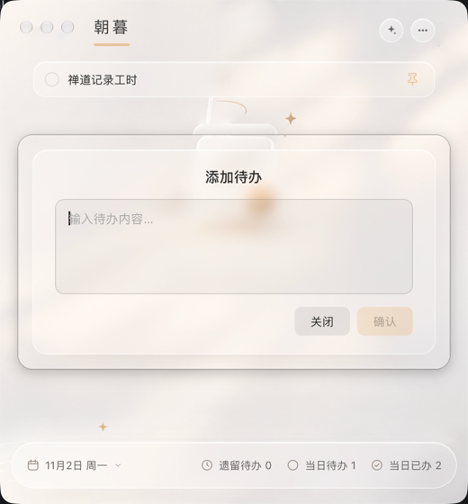
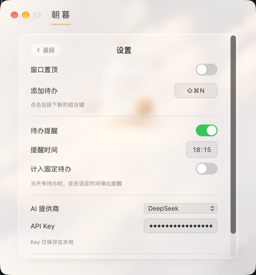

# 朝暮

一款优雅的 macOS 桌面待办应用，暖色磨砂玻璃风格，纯净、轻量、顺手。

## 界面预览

### 主界面

- 顶栏：品牌标识「朝暮」与金色装饰线；右侧两个圆形按钮分别为「AI 日报」与「设置」。
- 列表：每条待办为一张玻璃拟态卡片，包含圆形勾选框、待办文字；悬停时显示固定与删除按钮。
- 空状态：无待办时展示插画与提示。
- 底栏：展示日期（月日 + 星期）与「遗留待办 / 当日待办 / 当日已办」三项统计，均可点击切换筛选。

### 当日已办

- 点击底栏的「当日已办」，原地以只读方式列出今天已完成的事项，并支持一键回退。
- 再次点击取消筛选，交互与「当日待办 / 遗留待办」一致。

### 日历与历史已办

- 点击底栏日期弹出日历，有已办记录的日期带金色圆点标记，未来日期不可选。
- 选择过去的日期后，以只读方式展示当天已办事项，并通过「返回今天待办」按钮回到今日待办。

### 添加待办

- 通过全局快捷键（默认 `Cmd + Shift + N`）呼出的弹窗，自动聚焦输入框，支持多行输入。
- `Cmd/Ctrl + Enter` 提交，`Esc` 关闭，暖金色确认按钮。

### AI 日报

- 点击顶栏星标按钮进入，自动汇总当日已办事项，一键生成 AI 日报。
- 生成后可编辑、复制或重新生成。

### 设置

- 点击顶栏的「...」打开，风格与主界面保持一致。
- 提供窗口置顶、添加待办的全局快捷键录制、待办提醒（开关 / 提醒时间 / 是否计入固定待办）、AI 提供商与 API Key，以及版本检查更新。

### 待办提醒

- 到达设定的提醒时间后，会在主窗口内打开提醒页（与设置、AI 日报一致的页内视图）。
- 页面展示未完成待办数量与今日已完成清单，底部提供「今日不再提醒」。

## 功能一览

- **待办管理**：添加、勾选完成、删除、固定待办。
- **玻璃拟态视觉**：暖色磨砂玻璃卡片，金色点缀，圆润通透。
- **完成动效**：卡片沿曲线飞入「当日已办」并回弹，列表平滑重排。
- **底栏统计与筛选**：日期（月日 + 星期）、遗留待办、当日待办、当日已办；三项统计均可点击切换筛选。
- **日历回顾**：点击日期打开日历，有已办的日期显示圆点；选择过去日期以只读方式查看当天已办，一键返回今日待办。
- **待办提醒**：到达设定时间后，在主窗口内展示未完成数量与今日已完成清单，可「今日不再提醒」。
- **AI 日报**：汇总当日已办事项，调用已配置的 AI 提供商生成日报，支持编辑、复制与重新生成。
- **添加待办**：全局快捷键唤起，自动聚焦输入框；多行输入，`Cmd/Ctrl + Enter` 提交，`Esc` 关闭。
- **设置**：窗口置顶、快捷键录制、待办提醒、AI 提供商与 API Key、检查更新。
- **自定义全局快捷键**：默认 `Cmd + Shift + N` 添加待办，可在设置中录制修改。
- **窗口快捷键**：`Cmd + W` 隐藏窗口（点击 Dock 图标恢复）、`Cmd + M` 最小化（仅窗口聚焦时生效）。
- **自动保存**：待办与设置自动持久化，重启不丢失。
- **贴心细节**：无边框透明圆角窗口、动效降级、防误选文本。
